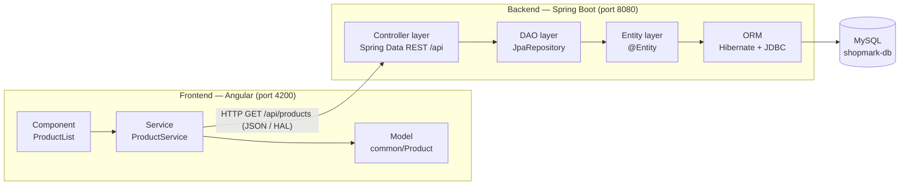
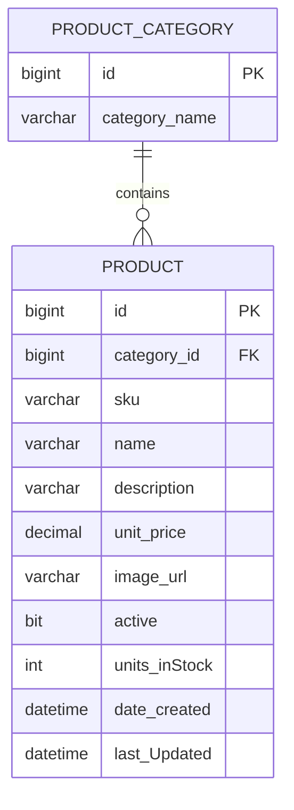
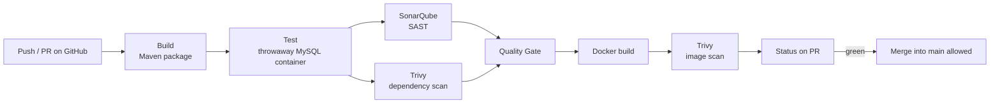

# ShopMarket

A full-stack e-commerce web application built with **Angular** and **Spring Boot**, used as a hands-on project for **DevOps / DevSecOps** practices (CI pipelines, quality gates, security scanning, containerisation).

> **Status:** Release 1 — read-only product catalog + backend CI pipeline.

---

## Tech stack

| Layer | Technology |
|---|---|
| Frontend | Angular 22 (standalone components, signals), TypeScript, Vitest |
| Backend | Java 17, Spring Boot 4.2, Spring Data JPA, Spring Data REST, Lombok |
| Database | MySQL (local, via XAMPP) |
| Build | Maven Wrapper (`mvnw`), npm |
| CI | Jenkins (Multibranch Pipeline), SonarQube, Trivy, Docker |

---

## Current features

- Product catalog page listing all products (name, SKU, price, stock, availability)
- Client-side search by name, SKU or description
- Loading and error states with retry
- REST API exposing products and product categories
- CI pipeline on every push and pull request, with merge into `main` blocked if the pipeline fails

---

## Architecture

### Overview



### Layers (Java full-stack terminology)

| Layer | Responsibility | In ShopMarket |
|---|---|---|
| **Component** (frontend) | UI rendering and user interaction | `components/product-list` |
| **Service** (frontend) | HTTP calls to the backend | `services/product.ts` (`ProductService`) |
| **Model** (frontend) | TypeScript mirror of the API data | `common/product.ts` |
| **Controller** | Exposes the REST API | Generated automatically by **Spring Data REST** from the repositories |
| **Service** (backend) | Business logic | *Not yet implemented* — the API calls the DAO directly |
| **DAO / Repository** | Data access | `dao/ProductRepository`, `dao/ProductCategoryRepository` |
| **Entity** | Java objects mapped to tables | `entity/Product`, `entity/ProductCategory` |
| **DTO** | API contract separate from entities | *Not yet implemented* — entities are serialised directly |
| **Config** | Framework configuration | `config/MyDataRestConfig` (read-only API, see Known issues) |
| **ORM / Persistence** | Object–relational mapping | Hibernate (JPA) + `mysql-connector-j` |

### Request flow

1. `ProductList` calls `ProductService.getProductList()`.
2. `ProductService` sends `GET http://localhost:8080/api/products`.
3. Spring Data REST maps the request to `ProductRepository.findAll()`.
4. Hibernate runs the SQL query on MySQL and maps rows to `Product` entities.
5. The response is returned as HAL JSON (`_embedded.products`), mapped to the frontend `Product` model.

---

## Data model



Tables are created and updated automatically by Hibernate (`spring.jpa.hibernate.ddl-auto=update`).

---

## REST API

Base path: `/api` (Spring Data REST, HAL format, paginated with `?page=0&size=20`)

| Method | Endpoint | Description |
|---|---|---|
| GET | `/api/products` | List products |
| GET | `/api/products/{id}` | Get one product |
| GET | `/api/products/{id}/category` | Category of a product |
| GET | `/api/product-category` | List categories |
| GET | `/api/product-category/{id}` | Get one category |

---

## Project structure

```
shopmarket/
├── backend/
│   └── spring-boot-shopmarket/
│       ├── src/main/java/com/shopmarket/spring_boot_shopmarket/
│       │   ├── config/        # MyDataRestConfig
│       │   ├── dao/           # Repositories (DAO layer)
│       │   └── entity/        # JPA entities
│       ├── src/main/resources/application.properties
│       ├── Dockerfile
│       ├── Jenkinsfile        # CI pipeline
│       └── pom.xml
└── frontend/
    └── angular-shopmarket/
        └── src/app/
            ├── common/        # Models
            ├── components/    # UI components
            └── services/      # HTTP services
```

---

## Getting started

### Prerequisites
- JDK 17
- Node.js (LTS) and npm
- MySQL running on `localhost:3306` (e.g. XAMPP)

### 1. Database
Create the database (tables are created automatically on first start):
```sql
CREATE DATABASE `shopmark-db`;
```
Then insert some categories and products to see data in the UI.

### 2. Backend
```bash
cd backend/spring-boot-shopmarket
./mvnw spring-boot:run        # Windows: mvnw.cmd spring-boot:run
```
API available at http://localhost:8080/api/products

### 3. Frontend
```bash
cd frontend/angular-shopmarket
npm install
npm start
```
App available at http://localhost:4200

---

## CI pipeline (backend)

Jenkins **Multibranch Pipeline** — runs on every push and every pull request (`backend/spring-boot-shopmarket/Jenkinsfile`).



- Pull requests are tested **merged with `main`**, so `main` only receives code that has passed.
- `main` is protected by a GitHub ruleset: pull request required + Jenkins status check must pass.
- Secrets (GitHub token, SonarQube token) are stored in the Jenkins credentials store, never in the repository.

---

## Known issues / technical debt

- **CORS** is not configured: the frontend (port 4200) and backend (port 8080) are on different origins.
- `MyDataRestConfig` is missing `@Configuration`, so POST / PUT / DELETE are still exposed.
- Database credentials are hard-coded in `application.properties` (root / empty password).
- `dockerignore` should be renamed `.dockerignore`, and `target/` should not be committed.
- The default Angular test (`app.spec.ts`) still expects the original *"Hello, angular-shopmarket"* title.
- No frontend CI pipeline yet.

---

## Roadmap

### Short term — clean monolith
- [ ] Fix the known issues above (CORS, `@Configuration`, secrets via environment variables)
- [ ] Add proper backend layers: `@RestController` → `@Service` → DAO, with **DTOs**
- [ ] Database migrations with **Flyway** instead of `ddl-auto=update`
- [ ] Frontend CI pipeline (lint, tests, build, `npm audit`, Docker image with Nginx)
- [ ] Product details page, categories menu, pagination

### Mid term — new business domains
- [ ] Shopping cart and checkout
- [ ] Orders and customers (`Order`, `OrderItem`, `Customer`)
- [ ] Authentication with **Keycloak** (OAuth2 / JWT)
- [ ] `docker-compose` to run the whole stack with one command

### Long term — microservices & cloud native
- [ ] Split into `product-service` and `order-service`, one database per service
- [ ] **Spring Cloud Gateway** as single entry point (routing, CORS, auth)
- [ ] Asynchronous events with **RabbitMQ** (e.g. `OrderPlaced` → stock update)
- [ ] Resilience with **Resilience4j** (circuit breaker, retry)
- [ ] Deployment on **Kubernetes** with Helm charts
- [ ] Observability: Prometheus, Grafana, OpenTelemetry tracing
- [ ] Continuous delivery: push images to a registry and deploy automatically from `main`

---

## Author

**AnasSabirx008**
